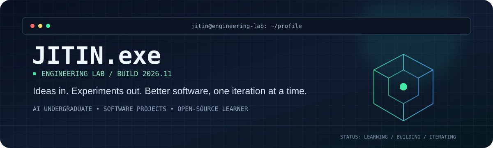
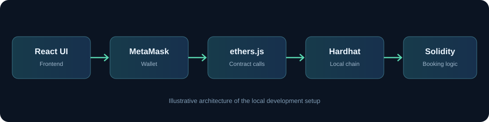

<!-- JITIN.exe | Engineering Lab -->

  

  
  
  
  

  <code>AI UNDERGRADUATE</code> &nbsp; <code>SOFTWARE PROJECTS</code> &nbsp; <code>OPEN-SOURCE LEARNER</code>

---

<table>
  <tr>
    <td width="58%" valign="top">
      <h2>01 / WHOAMI</h2>
      
I'm <strong>Jitin Jadwani</strong>, a B.Tech Artificial Intelligence student (2024–2028). I enjoy understanding how systems work and turning ideas into practical software.

      
This is my engineering lab: a place to document what I'm building, what I'm learning, and how my work evolves.

    </td>
    <td width="42%" valign="top">
      <h2>02 / CURRENT MODE</h2>
      
<strong>LEARNING</strong> C · Java · Python

      
<strong>BUILDING</strong> AI and software projects

      
<strong>EXPLORING</strong> Open-source collaboration

    </td>
  </tr>
</table>

## 03 / FEATURED BUILD

<h3>01 — BlockSphere</h3>

**Smart-contract-based event ticket booking**

A React + Solidity project exploring event creation, ticket inventory, bookings, cancellations, refunds, and organizer withdrawals through a smart contract.

  
  
  
  
  

| Project snapshot | Details |
|---|---|
| Status | Active development |
| Scope | Academic/local-network prototype |
| Contract workflow | Local Hardhat network and contract tests |
| Deployment claim | No public-chain or production deployment claimed |

<table>
  <tr>
    <td width="50%">
      
      
EVENT DISCOVERY

    </td>
    <td width="50%">
      
      
BOOKING FLOW

    </td>
  </tr>
</table>

  

  <a href="https://github.com/Jitin7Coder/BlockSphere"><strong>EXPLORE SOURCE & SETUP</strong></a>
  &nbsp;·&nbsp;
  <a href="https://block-sphere-two.vercel.app/"><strong>OPEN FRONTEND PREVIEW</strong></a>

---

## 04 / OTHER WORK

<table>
  <tr>
    <td width="50%" valign="top">
      <h3>DriveDoctor-AI</h3>
      
AI-assisted vehicle diagnosis and maintenance project.

      
<code>IN DEVELOPMENT</code>

      <a href="https://github.com/Jitin7Coder/DriveDoctor-AI">VIEW REPOSITORY →</a>
    </td>
    <td width="50%" valign="top">
      <h3>Python_spotify</h3>
      
An earlier learning idea exploring music data and sleep duration.

      
<code>ARCHIVED LEARNING WORK</code>

      <a href="https://github.com/Jitin7Coder/Python_spotify">VIEW REPOSITORY →</a>
    </td>
  </tr>
</table>

## 05 / TOOLCHAIN

| Category | Technologies |
|---|---|
| Learning | C · Java · Python |
| Used in projects | JavaScript · React |
| Blockchain project work | Solidity · Hardhat · ethers.js · MetaMask |
| Workflow | Git · GitHub |

*Learning tools and project experience are listed separately to keep this profile accurate.*

## 06 / WHAT'S NEXT

- Strengthen programming fundamentals and problem-solving.
- Improve project quality through testing, debugging, and documentation.
- Learn issue triage, pull requests, code review, and open-source collaboration.
- Continue exploring practical AI/ML applications.

## 07 / ELSEWHERE ON THE INTERNET

  <a href="https://jitin-jai-jadwani-upgraded-portfolio.netlify.app/">UPGRADED PORTFOLIO</a>
  &nbsp;·&nbsp;
  <a href="https://jitin-jai-jadwani.netlify.app/">ORIGINAL PORTFOLIO</a>
  &nbsp;·&nbsp;
  <a href="https://www.linkedin.com/in/jitin-jai-jadwani/">LINKEDIN</a>
  &nbsp;·&nbsp;
  <a href="https://www.hackerrank.com/profile/2024_jitin_jadw1">HACKERRANK</a>

---

  <strong>JITIN.exe</strong> · Engineering is an iterative process. So is this profile.

